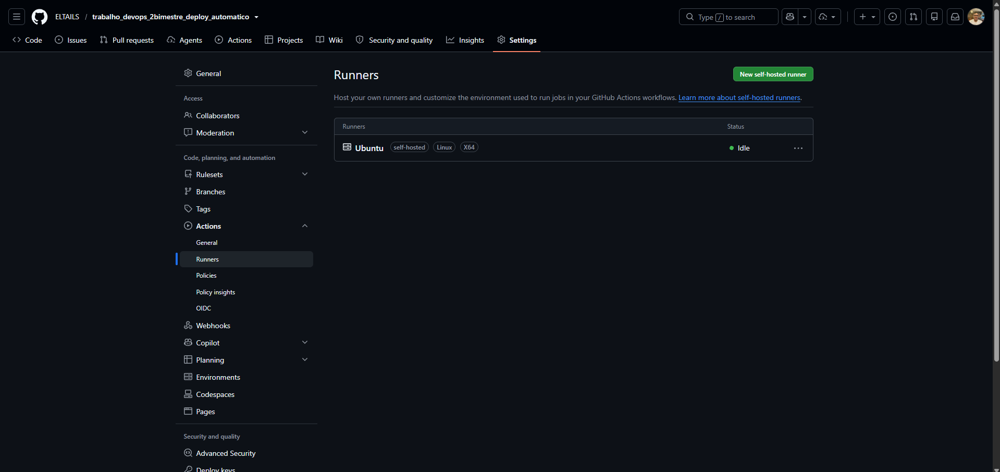
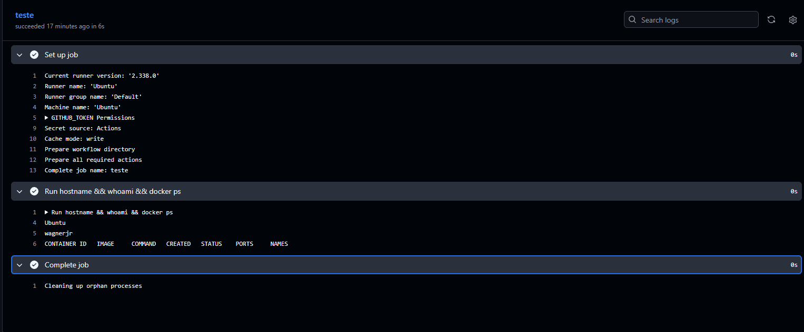
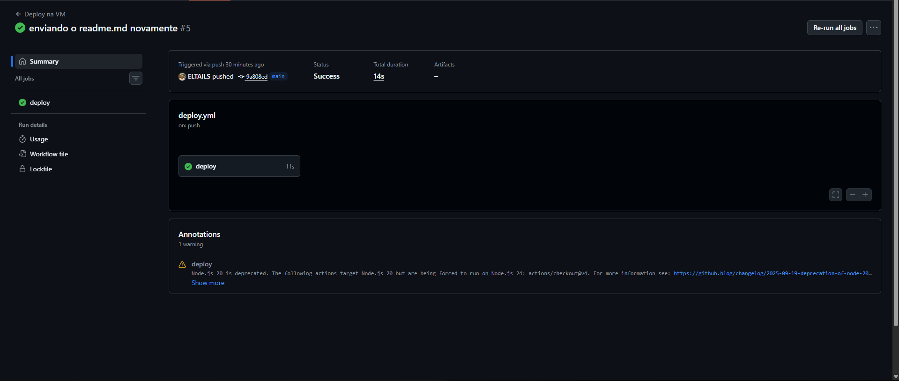
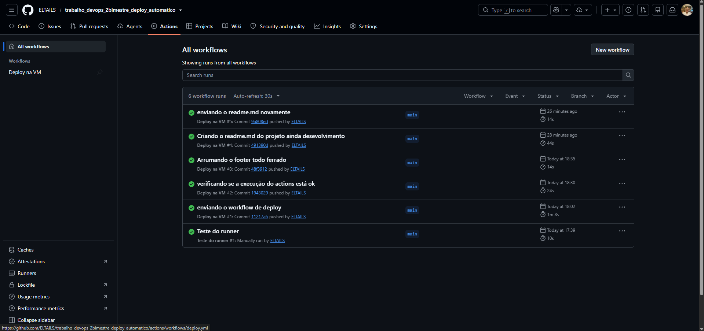

# Deploy automático em VM com GitHub Actions (Runner self-hosted)

Trabalho 2 de Ferramentas DevOps Avançadas, UniALFA.

## Integrantes

- Wagner da Silva Junior
- Adrian Arcanjo

## Sumário

1. [Sobre o projeto](#sobre-o-projeto)
2. [Tecnologias utilizadas](#tecnologias-utilizadas)
3. [Como funciona o Runner local e o deploy automático](#como-funciona-o-runner-local-e-o-deploy-automático)
4. [Passo a passo: instalar tudo em uma VM do zero](#passo-a-passo-instalar-tudo-em-uma-vm-do-zero)
5. [Como acessar a aplicação na VM](#como-acessar-a-aplicação-na-vm)
6. [Evidências (prints)](#evidências-prints)
7. [Problemas comuns](#problemas-comuns)

---

## Sobre o projeto

O **Atacadão do Inferno** é um CRUD (Create, Read, Update e Delete) de produtos de um mercado. Pelo navegador é possível:

- **Create:** cadastrar um produto;
- **Read:** listar os produtos e ver os detalhes de cada um;
- **Update:** atualizar os dados de um produto;
- **Delete:** excluir um produto.

A aplicação é a mesma desenvolvida no 1º bimestre ([trabalho_docker_1_bimestre](https://github.com/ELTAILS/trabalho_docker_1_bimestre)). Neste trabalho ela foi adaptada para ser **atualizada automaticamente em uma máquina virtual**: a cada `push` na branch `main`, o GitHub Actions executa o deploy na VM, sem nenhum comando manual.

Organização do código (arquitetura em camadas):

```text
Usuário
   ↓
Rotas        frontend/index.php
   ↓
Controller   backend/Controller/ProdutoController.php
   ↓
Service      backend/Service/ProdutoService.php
   ↓
Repository   backend/Repository/ProdutoRepo.php
   ↓
MySQL        banco "atacadao"
   ↓
Views        frontend/pages e frontend/componentes
```

---

## Tecnologias utilizadas

| Tecnologia | Para que serve neste projeto |
| :--- | :--- |
| **Ubuntu Server** (em VM no VirtualBox) | Máquina que hospeda a aplicação e o Runner |
| **OpenSSH Server** | Acesso remoto à VM (SSH, porta 22, usado com PuTTY) |
| **Git** | Controle de versão e envio do código ao GitHub |
| **Docker Engine + Docker Compose (plugin)** | Executa a aplicação em containers |
| **GitHub Actions** | Automação do deploy a cada `push` |
| **Runner self-hosted** | Programa instalado na VM que executa os workflows do GitHub |
| **PHP 8.3 + Apache** (imagem `php:8.3-apache`) | Back-end e servidor web |
| **MySQL 8.4** | Banco de dados dos produtos |
| **phpMyAdmin** | Interface web do banco |
| **Composer** (imagem `composer:2`) | Gera o autoload das classes (`vendor/`) durante o deploy |
| **HTML, CSS e Bootstrap** | Interface |

Os containers sobem com o `compose.yml`: `php` (porta 8000), `db` e `phpmyadmin` (porta 8001).

---

## Como funciona o Runner local e o deploy automático

### O Runner local (self-hosted)

Normalmente os workflows do GitHub Actions rodam em máquinas do próprio GitHub. Aqui, instalamos um **Runner** dentro da nossa VM Ubuntu Server. Ele é um programa que fica rodando como serviço do sistema, conectado ao repositório, esperando trabalho. Quando um workflow pede `runs-on: self-hosted`, o GitHub entrega o trabalho para esse Runner, que executa os comandos **dentro da VM**, com acesso ao Docker dela. É isso que permite atualizar a aplicação que roda na própria VM.

No GitHub, o Runner aparece em **Settings → Actions → Runners** com o status **Idle** (online, aguardando) ou **Active** (executando).

### A Action de deploy

O arquivo `.github/workflows/deploy.yml` é disparado por **`push` na branch `main`** e executa 3 passos no Runner da VM:

1. **Baixar código** (`actions/checkout`): copia a versão mais nova do repositório para a pasta de trabalho do Runner.
2. **Instalar dependências (Composer):** executa o Composer dentro de um container (`composer:2`) para gerar a pasta `vendor/`, que não vai para o Git.
3. **Atualizar aplicação** (`docker compose up -d`): sobe os containers. Como o código da pasta é compartilhado com o container PHP por volume, os arquivos novos já passam a ser servidos; se o `compose.yml` mudou, os containers afetados são recriados.

O banco de dados fica em um volume do Docker, então os dados **não são apagados** a cada deploy. Na primeira vez que o volume é criado, o MySQL executa automaticamente o `backend/Database/produtos.sql`, criando a tabela e os dados de exemplo.

**Fluxo completo:**

```text
git push (main) → GitHub dispara o workflow → Runner na VM recebe o trabalho
   → baixa o código → instala o autoload → docker compose up -d → nova versão no navegador
```

---

## Passo a passo: instalar tudo em uma VM do zero

Siga na ordem. No final, cada `push` na `main` atualizará a aplicação sozinho.

### 1. Criar a VM

1. Instale o **VirtualBox** e crie uma VM com **Ubuntu Server** (recomendado: 2 GB de RAM, 2 CPUs e 25 GB de disco ou mais).
2. Em **Configurações → Rede**, use **Adaptador em Modo Bridge**, para a VM ter um IP da mesma rede do computador que vai acessá-la.
3. Durante a instalação marque **Install OpenSSH server** (se não marcar, veja o passo 2).

### 2. Preparar o acesso remoto (SSH)

Dentro da VM:

```bash
sudo apt update
sudo apt install -y openssh-server
sudo systemctl enable --now ssh
ip -4 addr show     # anote o IP da VM
```

Depois, de qualquer computador da rede, conecte pelo **PuTTY** (ou pelo terminal) usando o IP da VM e a **porta 22**:

```bash
ssh SEU_USUARIO@IP_DA_VM
```

### 3. Instalar Git e Docker (com Docker Compose)

Conectado na VM, siga o método oficial do Docker (<https://docs.docker.com/engine/install/ubuntu/>):

```bash
sudo apt update
sudo apt install -y ca-certificates curl git
sudo install -m 0755 -d /etc/apt/keyrings
sudo curl -fsSL https://download.docker.com/linux/ubuntu/gpg -o /etc/apt/keyrings/docker.asc
sudo chmod a+r /etc/apt/keyrings/docker.asc
echo "deb [arch=$(dpkg --print-architecture) signed-by=/etc/apt/keyrings/docker.asc] https://download.docker.com/linux/ubuntu $(. /etc/os-release && echo "${UBUNTU_CODENAME:-$VERSION_CODENAME}") stable" | sudo tee /etc/apt/sources.list.d/docker.list > /dev/null
sudo apt update
sudo apt install -y docker-ce docker-ce-cli containerd.io docker-buildx-plugin docker-compose-plugin
```

Permita usar o Docker sem `sudo` (necessário para o Runner) e **saia e entre de novo** na sessão SSH:

```bash
sudo usermod -aG docker $USER
exit
```

Depois de reconectar, confira:

```bash
docker --version
docker compose version
docker ps
```

### 4. Garantir que as portas estão livres

```bash
ss -tlnp | grep -E ':(8000|8001|3306)\b'
```

Se não aparecer nada, siga em frente. Se a porta **3306** estiver ocupada por outro MySQL, apague a linha `- "3306:3306"` do serviço `db` no `compose.yml` (a aplicação acessa o banco pela rede interna do Docker e não precisa dela).

### 5. Colocar o projeto no seu GitHub

1. Faça um **fork** deste repositório (ou crie um repositório novo e envie estes arquivos para ele).
2. Você precisa ser **administrador** do repositório para registrar o Runner.

### 6. Instalar e registrar o Runner na VM

1. No repositório: **Settings → Actions → Runners → New self-hosted runner**, escolha **Linux** e **x64**.
2. Na VM, **como usuário normal (nunca root)**, crie uma pasta própria para o Runner:

   ```bash
   mkdir ~/actions-runner && cd ~/actions-runner
   ```

3. Dentro dela, execute os comandos dos blocos **Download** e **Configure** exibidos na página do GitHub (a versão do Runner e o token mudam, por isso copie de lá; o token expira em cerca de 1 hora). Na pergunta de configuração, aceite os valores padrão com Enter.
4. Instale o Runner como serviço, para ele continuar rodando após fechar o terminal ou reiniciar a VM:

   ```bash
   sudo ./svc.sh install
   sudo ./svc.sh start
   sudo ./svc.sh status
   ```

5. Confirme em **Settings → Actions → Runners** que o Runner está **Idle** (verde).

### 7. Testar o Runner

Crie um workflow simples de teste (`.github/workflows/teste-runner.yml`):

```yaml
name: Teste do runner
on: workflow_dispatch
jobs:
  teste:
    runs-on: self-hosted
    steps:
      - run: hostname && whoami && docker ps
```

Rode-o em **Actions → Run workflow**. Se aparecer o nome da VM e o `docker ps` funcionar sem `sudo`, o Runner e o Docker estão corretos.

### 8. Fazer o primeiro deploy

Com o arquivo `.github/workflows/deploy.yml` presente no repositório, basta fazer um `push` na `main`:

```bash
git add .
git commit -m "primeiro deploy"
git push
```

Acompanhe em **Actions**: a execução **Deploy na VM** deve ficar verde. No primeiro deploy o container PHP instala as extensões do PHP ao iniciar, então a aplicação pode levar **1 a 2 minutos** para responder.

### 9. Alternativa sem Runner (execução manual na VM)

Apenas para testar a aplicação sem o GitHub Actions:

```bash
git clone https://github.com/SEU_USUARIO/SEU_REPOSITORIO.git
cd SEU_REPOSITORIO
docker run --rm --user "$(id -u):$(id -g)" -v "$PWD":/app -w /app composer:2 install --no-dev --optimize-autoloader
docker compose up -d
```

---

## Como acessar a aplicação na VM

| O que | Endereço |
| :--- | :--- |
| **Aplicação (CRUD)** | `http://192.168.4.167:8000` |
| **phpMyAdmin** | `http://192.168.4.167:8001` (usuário e senha definidos no `compose.yml`) |
| **Acesso SSH à VM (PuTTY)** | IP `192.168.4.167`, porta `22` |

O IP é da rede local do laboratório: só é acessível por computadores conectados a essa mesma rede.

### Demonstração da atualização automática

1. Alteramos um conteúdo visível da aplicação.
2. Enviamos a alteração ao GitHub com `git push`.
3. A Action de deploy executou sozinha na VM (veja o histórico em **Actions**).
4. Ao recarregar `http://192.168.4.167:8000`, a nova versão já estava no ar, sem nenhum deploy manual.

---

## Evidências (prints)

### Runner online na VM


### Teste do Runner executando na VM


### Execução do deploy (Actions)


### Aplicação antes da alteração


### Aplicação depois da alteração (nova versão no navegador)


### Histórico de execuções


---

## Problemas comuns

| Sintoma | O que fazer |
| :--- | :--- |
| Site não abre logo após o deploy | Aguarde 1 a 2 minutos (o PHP instala extensões ao iniciar). Veja `docker ps` e `docker logs myapp_php --tail 30`. |
| `permission denied` ao usar o Docker | O usuário do Runner não está no grupo `docker`. Rode `sudo usermod -aG docker $USER`, reconecte e reinicie o serviço: `sudo ./svc.sh stop && sudo ./svc.sh start`. |
| Runner aparece **Offline** | Na pasta do Runner, rode `sudo ./svc.sh status` e, se preciso, `sudo ./svc.sh start`. |
| Aplicação abre, mas sem tabela/produtos | O volume do banco já existia vazio. Na pasta de trabalho do Runner (`~/actions-runner/_work/REPO/REPO`), rode `docker compose down -v` e faça um novo `push`. |
| Porta já em uso | Veja o passo 4 e libere a porta ou remova o container antigo com `docker rm -f NOME`. |
| `git push` pede senha e falha | O GitHub não aceita senha: use chave SSH ou um Personal Access Token com os escopos `repo` e `workflow`. |

