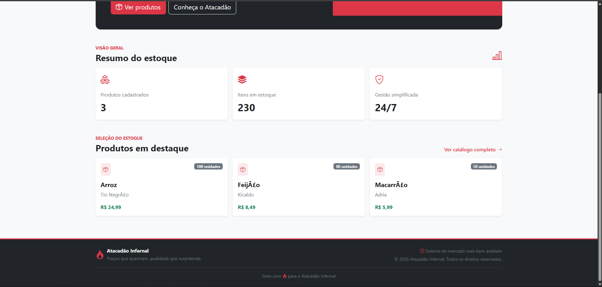
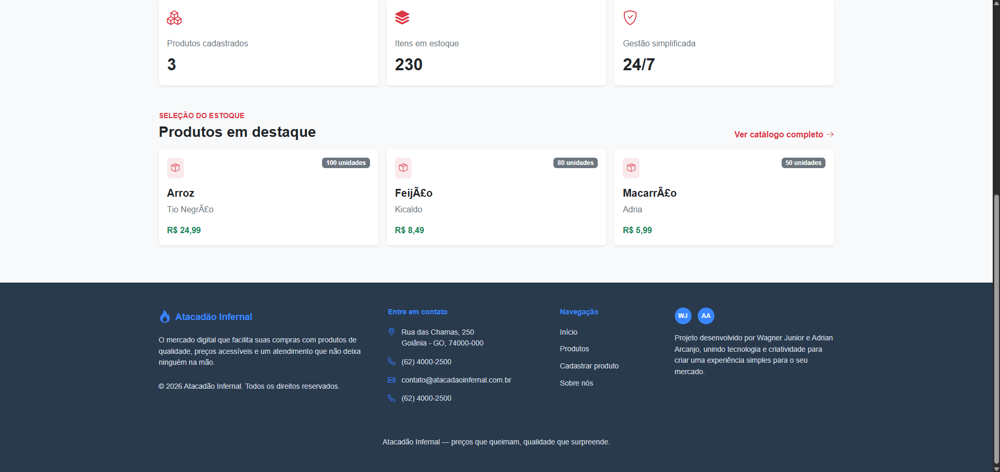

# Trabalho 2 — Deploy automático em VM (ubuntu server)

Trabalho de DevOps Avançado — UniALFA

## Integrantes

- Wagner da Silva Junior
- Adrian Arcanjo

## Sumário

1. [Objetivo](#objetivo)
2. [Aplicação CRUD](#aplicação-crud)
3. [Tecnologias utilizadas](#tecnologias-utilizadas)
4. [Runner self-hosted e deploy automático](#runner-self-hosted-e-deploy-automático)
5. [Pré-requisitos](#pré-requisitos)
6. [Configuração da VM](#configuração-da-vm)
7. [Instalação e registro do Runner](#instalação-e-registro-do-runner)
8. [Primeiro deploy](#primeiro-deploy)
9. [Acesso à aplicação](#acesso-à-aplicação)
10. [Demonstração da atualização automática](#demonstração-da-atualização-automática)
11. [Evidências](#evidências)
12. [Problemas comuns](#problemas-comuns)

---

## Objetivo

Este Trabalho 2 demonstra a atualização automática de uma aplicação CRUD em uma
máquina virtual. Um Runner local (self-hosted) do GitHub Actions é instalado na
VM e executa o workflow de deploy diretamente nela. Assim, depois de um `push`
na branch `main`, a aplicação é atualizada sem executar um deploy manual.

---

## Aplicação CRUD

O projeto é o **Atacadão Infernal**, um CRUD de produtos. Pela aplicação, o
usuário pode:

- **Create:** cadastrar um produto;
- **Read:** listar produtos e consultar seus detalhes;
- **Update:** alterar os dados de um produto;
- **Delete:** excluir um produto.

A aplicação usa PHP com uma arquitetura em camadas:

```text
Navegador
   ↓
frontend/index.php
   ↓
backend/Controller/ProdutoController.php
   ↓
backend/Service/ProdutoService.php
   ↓
backend/Repository/ProdutoRepo.php
   ↓
MySQL (banco atacadao)
```

O script [backend/Database/produtos.sql](backend/Database/produtos.sql) cria a
tabela `produtos` e insere dados iniciais quando o volume do MySQL é criado
pela primeira vez.

---

## Tecnologias utilizadas

| Tecnologia | Uso no projeto |
| :--- | :--- |
| Ubuntu Server em uma VM | Hospeda a aplicação, os containers e o Runner |
| OpenSSH Server | Acesso remoto à VM pela porta 22 |
| Git e GitHub | Versionamento e envio das alterações |
| GitHub Actions | Automação do deploy |
| Runner self-hosted | Executa o workflow dentro da VM |
| Docker Engine e Docker Compose | Execução dos serviços |
| PHP 8.3 com Apache | Servidor web e aplicação |
| MySQL 8.4 | Banco de dados |
| phpMyAdmin | Administração do banco pela interface web |
| Composer | Geração do autoload das classes PHP |
| HTML, CSS e Bootstrap | Interface da aplicação |

Os serviços estão definidos em [compose.yml](compose.yml):

- `php`: aplicação PHP/Apache, publicada na porta `8000`;
- `db`: banco MySQL, publicado na porta `3306`;
- `phpmyadmin`: interface do banco, publicada na porta `8001`.

O volume Docker `mysql_data` mantém os dados do banco entre os deploys. O
arquivo SQL de inicialização só é executado automaticamente quando o MySQL
inicia com um volume novo.

---

## Runner self-hosted e deploy automático

### Como o Runner funciona

O Runner self-hosted é um programa instalado e registrado no repositório
GitHub. Ele permanece como serviço na VM, conectado ao GitHub e aguardando
workflows. Quando um job declara `runs-on: self-hosted`, o GitHub entrega esse
job ao Runner disponível, que executa os comandos na própria VM e usa o Docker
instalado nela.

No repositório, o Runner pode ser acompanhado em **Settings → Actions →
Runners**. O status **Idle** indica que ele está online e aguardando uma
execução; durante um workflow, ele aparece como ocupado.

### Workflow de deploy

O workflow [deploy.yml](.github/workflows/deploy.yml) é executado somente em
`push` para a branch `main` e possui estas etapas:

1. `actions/checkout@v4` baixa o código atualizado para o workspace do Runner;
2. o container `composer:2` executa `composer install --no-dev
   --optimize-autoloader` e gera a pasta `vendor/`;
3. `docker compose up -d --remove-orphans` cria ou atualiza os containers da
   aplicação na VM.

Fluxo completo:

```text
git push main
    ↓
GitHub Actions encontra o Runner self-hosted
    ↓
checkout do código + instalação do autoload
    ↓
docker compose up -d --remove-orphans
    ↓
nova versão disponível na VM
```

Como o código do repositório é montado no container PHP por volume, os arquivos
atualizados passam a ser servidos depois do deploy. Se o `compose.yml` for
alterado, o Compose recria os serviços necessários. O volume `mysql_data` não é
removido pelo workflow, portanto os dados do banco permanecem.

---

## Pré-requisitos

- Conta com permissão de administrador no repositório GitHub;
- VirtualBox ou outro virtualizador;
- VM com Ubuntu Server, preferencialmente com pelo menos 2 GB de RAM, 2 CPUs e
  25 GB de disco;
- rede da VM configurada em modo Bridge, para que ela receba um IP acessível
  pelos computadores do laboratório;
- acesso à VM por SSH;
- Git, Docker Engine e Docker Compose instalados na VM.

---

## Configuração da VM

### 1. Instalar o Ubuntu Server e o SSH

Durante a instalação do Ubuntu Server, habilite o **OpenSSH Server**. Caso ele
não tenha sido instalado, execute na VM:

```bash
sudo apt update
sudo apt install -y openssh-server
sudo systemctl enable --now ssh
ip -4 addr show
```

Anote o endereço IPv4 da VM. De outro computador da rede, a conexão pode ser
testada com:

```bash
ssh SEU_USUARIO@IP_DA_VM
```

Também é possível usar o PuTTY com o mesmo IP e a porta `22`.

### 2. Instalar Git e Docker

Use o método oficial do Docker para a versão do Ubuntu instalada:
<https://docs.docker.com/engine/install/ubuntu/>.

O conjunto mínimo de pacotes é:

```bash
sudo apt update
sudo apt install -y ca-certificates curl git
sudo install -m 0755 -d /etc/apt/keyrings
sudo curl -fsSL https://download.docker.com/linux/ubuntu/gpg -o /etc/apt/keyrings/docker.asc
sudo chmod a+r /etc/apt/keyrings/docker.asc
echo "deb [arch=$(dpkg --print-architecture) signed-by=/etc/apt/keyrings/docker.asc] https://download.docker.com/linux/ubuntu $(. /etc/os-release && echo "${UBUNTU_CODENAME:-$VERSION_CODENAME}") stable" | sudo tee /etc/apt/sources.list.d/docker.list > /dev/null
sudo apt update
sudo apt install -y docker-ce docker-ce-cli containerd.io docker-buildx-plugin docker-compose-plugin
```

Adicione o usuário que executará o Runner ao grupo `docker` e reconecte-se à
VM para que a permissão seja aplicada:

```bash
sudo usermod -aG docker "$USER"
exit
```

Depois de conectar novamente, valide:

```bash
docker --version
docker compose version
docker ps
```

### 3. Conferir as portas

As portas usadas pelo Compose são `8000`, `8001` e `3306`:

```bash
ss -tlnp | grep -E ':(8000|8001|3306)\b'
```

Se a porta `3306` estiver ocupada e o acesso externo ao MySQL não for
necessário, remova somente o mapeamento `- "3306:3306"` de `compose.yml`. A
aplicação e o phpMyAdmin continuam acessando o banco pela rede interna do
Docker.

---

## Instalação e registro do Runner

1. No repositório, abra **Settings → Actions → Runners → New self-hosted
   runner**.
2. Selecione **Linux** e **x64**.
3. Na VM, como usuário normal (não use `root`), crie a pasta do Runner:

   ```bash
   mkdir -p ~/actions-runner
   cd ~/actions-runner
   ```

4. Copie da página do GitHub os comandos das seções **Download** e
   **Configure** e execute-os dentro dessa pasta. A versão do Runner e o token
   são fornecidos pelo GitHub; o token é temporário e não deve ser
   compartilhado.
5. Instale o Runner como serviço:

   ```bash
   sudo ./svc.sh install
   sudo ./svc.sh start
   sudo ./svc.sh status
   ```

6. Confirme no GitHub que o Runner aparece online com o status **Idle**.

Para validar que o Runner executa comandos na VM, pode-se criar
temporariamente, pelo editor do GitHub, um workflow manual em
`.github/workflows/teste-runner.yml`:

```yaml
name: Teste do Runner

on:
  workflow_dispatch:

jobs:
  teste:
    runs-on: self-hosted
    steps:
      - name: Verificar VM e Docker
        run: hostname && whoami && docker ps
```

Execute-o em **Actions → Teste do Runner → Run workflow**. O log deve mostrar o
hostname da VM, o usuário do Runner e a saída do `docker ps`. Esse workflow é
apenas um diagnóstico; o deploy versionado neste repositório é o
[deploy.yml](.github/workflows/deploy.yml).

---

## Primeiro deploy

Com o Runner online e o workflow presente na branch `main`, envie uma
alteração:

```bash
git add .
git commit -m "configura deploy automático"
git push origin main
```

No GitHub, abra **Actions → Deploy na VM** e acompanhe a execução. Quando todos
os passos estiverem verdes, confira os containers na VM:

```bash
docker compose ps
```

Na primeira execução, o container PHP compila as extensões `mysqli`, `pdo` e
`pdo_mysql` ao iniciar, por isso o primeiro acesso pode demorar. Os deploys
seguintes podem usar os containers já criados.

---

## Acesso à aplicação

### generica

Substitua `<IP_DA_VM>` pelo endereço IPv4 anotado durante a configuração:

| Serviço | Endereço |
| :--- | :--- |
| Aplicação CRUD | `http://<IP_DA_VM>:8000` |
| phpMyAdmin | `http://<IP_DA_VM>:8001` |
| SSH/PuTTY | `<IP_DA_VM>`, porta `22` |


### no laboratório

| Serviço | Endereço |
| :--- | :--- |
| Aplicação CRUD | `http://192.168.4.167:8000` |
| phpMyAdmin | `http://192.168.4.167:8001` |
| SSH/PuTTY | `192.168.4.167`, porta `22` |

### continuação

No phpMyAdmin, o servidor é `db`. As credenciais configuradas no
[compose.yml](compose.yml) são:

- usuário: `presidente`;
- senha: `inferno`.

O usuário `root` do MySQL usa a senha definida em `compose.yml`. Em um ambiente
real, substitua essas credenciais de exemplo por valores armazenados de forma
segura.

---

## Demonstração da atualização automática

Para atender à demonstração solicitada:

1. altere um texto visível da aplicação, por exemplo em uma página dentro de
   `frontend/pages/`;
2. faça `git add`, `git commit` e `git push origin main`;
3. verifique em **Actions** a execução bem-sucedida de **Deploy na VM**;
4. recarregue `http://<IP_DA_VM>:8000` e confirme a alteração no navegador.

Nenhum `docker compose up` manual é necessário na VM: essa etapa é executada
pelo Runner no workflow.

---

## Evidências

As imagens registradas neste repositório documentam o funcionamento exigido:

### Runner online na VM


### Teste do Runner executando na VM


### Deploy concluído com sucesso


### Antes da alteração


### Depois da alteração


### Histórico das execuções


---

## Problemas comuns

| Sintoma | Solução |
| :--- | :--- |
| O Runner aparece offline | Na pasta `~/actions-runner`, execute `sudo ./svc.sh status` e, se necessário, `sudo ./svc.sh start`. |
| `permission denied` ao usar Docker | Confirme que o usuário do Runner está no grupo `docker`, reconecte-se à VM e reinicie o serviço do Runner. |
| O workflow fica aguardando um Runner | Verifique se o Runner está online, se é Linux x64 e se o job usa `runs-on: self-hosted`. |
| O site não abre logo após o primeiro deploy | Aguarde a instalação das extensões PHP e consulte `docker compose ps` e `docker logs myapp_php --tail 30`. |
| A aplicação abre sem produtos | A inicialização SQL só ocorre com um volume novo. Se ainda não houver dados a preservar, pare os serviços com `docker compose down -v` e execute um novo deploy. |
| Uma porta já está em uso | Identifique o processo com `ss -tlnp`, libere a porta ou ajuste o mapeamento em `compose.yml`. |
| Os dados desapareceram após `docker compose down -v` | Esse comando remove o volume `mysql_data`; não o use em uma instalação com dados que precisam ser preservados. |
| `git push` pede senha | O GitHub não aceita a senha da conta para Git; use uma chave SSH ou um Personal Access Token com as permissões necessárias. |
